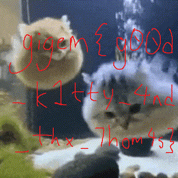

# skretch

Author: `flocto`

If only I could lay my eyes on that flag, that beautiful flag, one more time.

<a href='https://drive.google.com/file/d/1knL6xlSdIB9J1hNfy12Zng8lnYrbddv4/view?usp=drive_link' target='_blank'>dist</a>

## Dev Notes

The commited sb3 only checks first 1000 bytes. check gdrive for full one (also zstd compressed)

## Solution

After extracting and cleaning up the linear equations that check the bytes of the flag, you can use any sparse matrix solver. Or if you're cool, you can also use [a variant of the Thomas algorithm](https://en.wikipedia.org/wiki/Tridiagonal_matrix_algorithm#Variants) to solve the system of equations in O(n) time. See `poc/` for more info.

The solution is a PNG file that when opened, shows the flag:

flag:
`gigem{g00d_k1tty_4nd_thx_7hom4s}`
